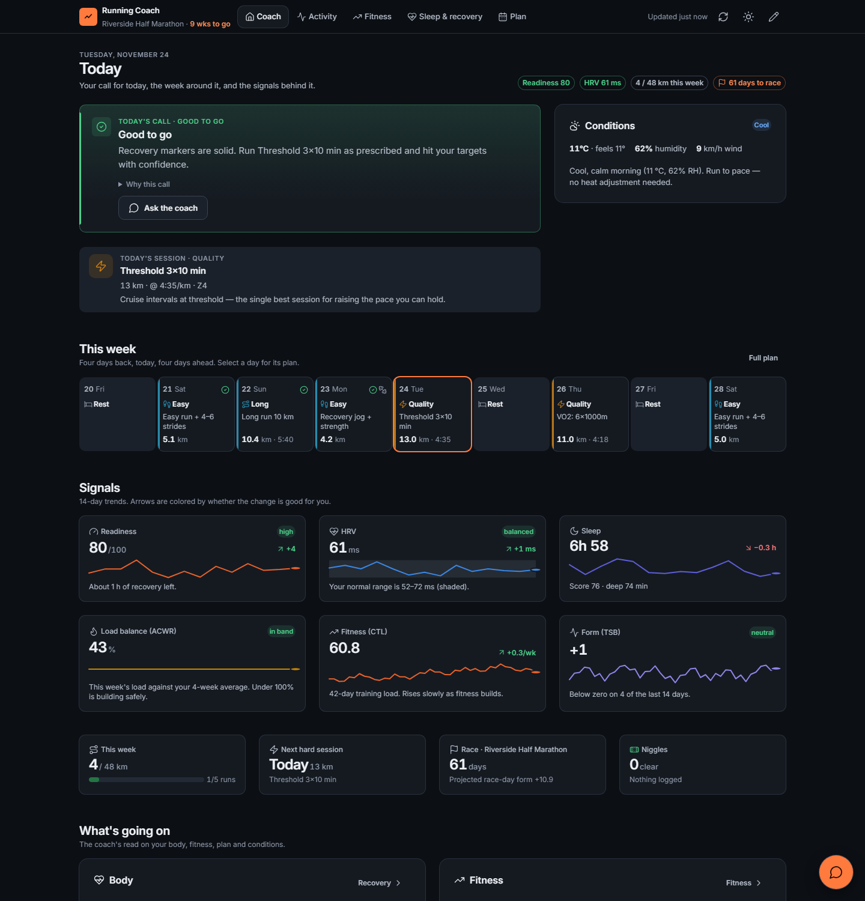
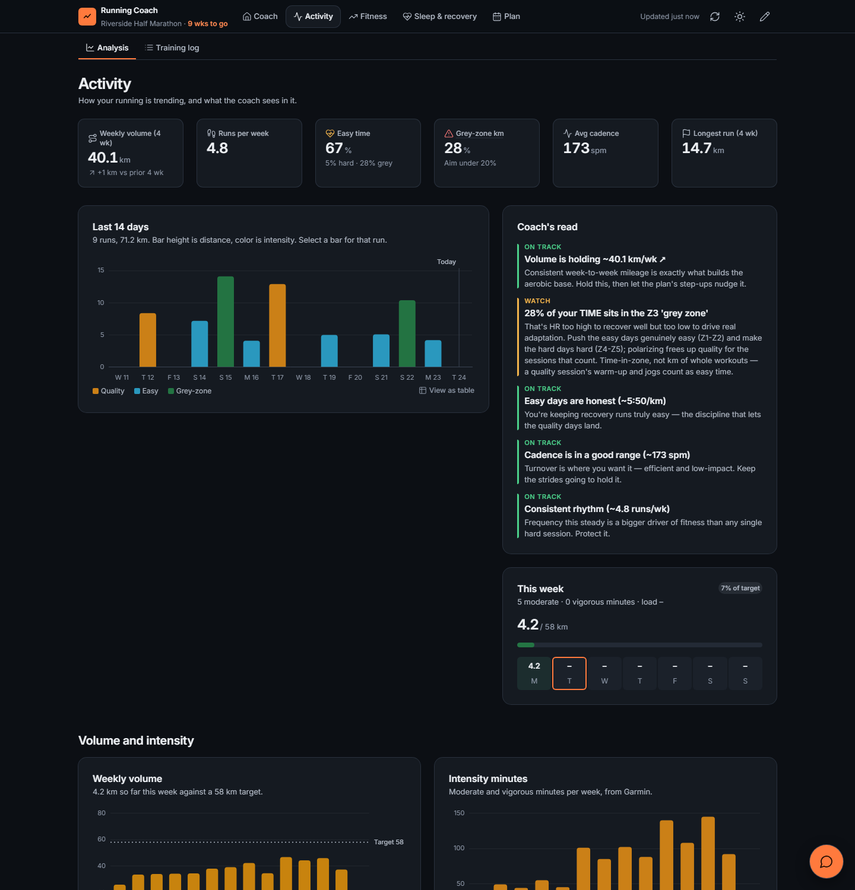
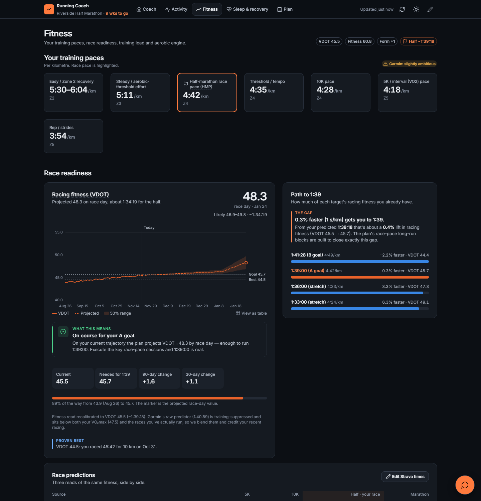
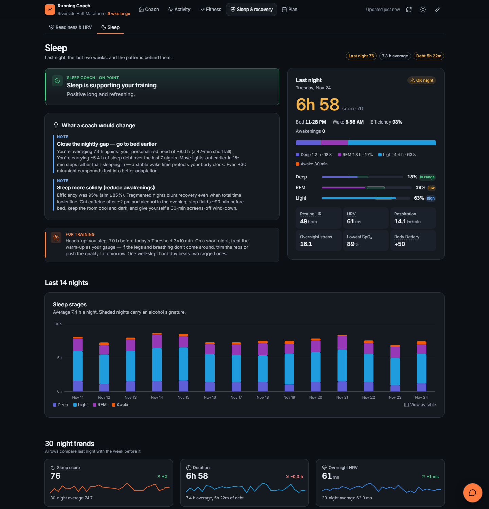
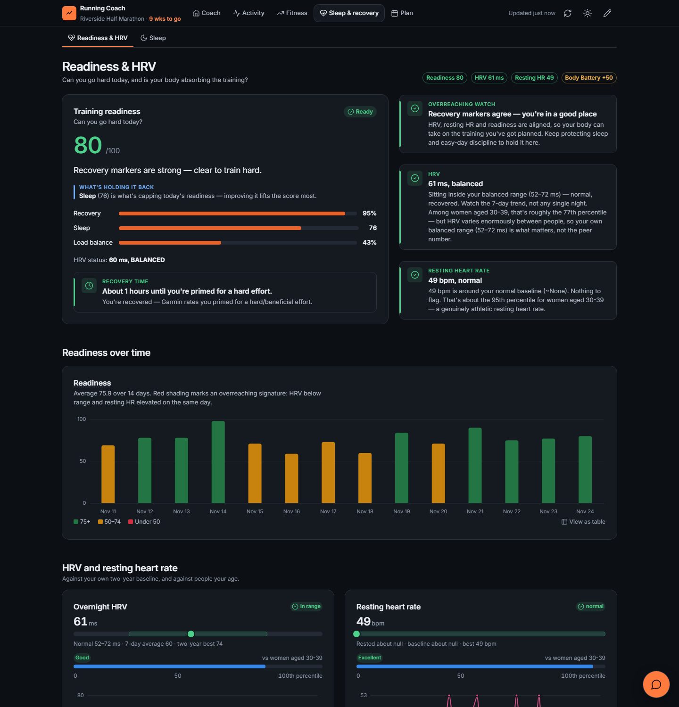
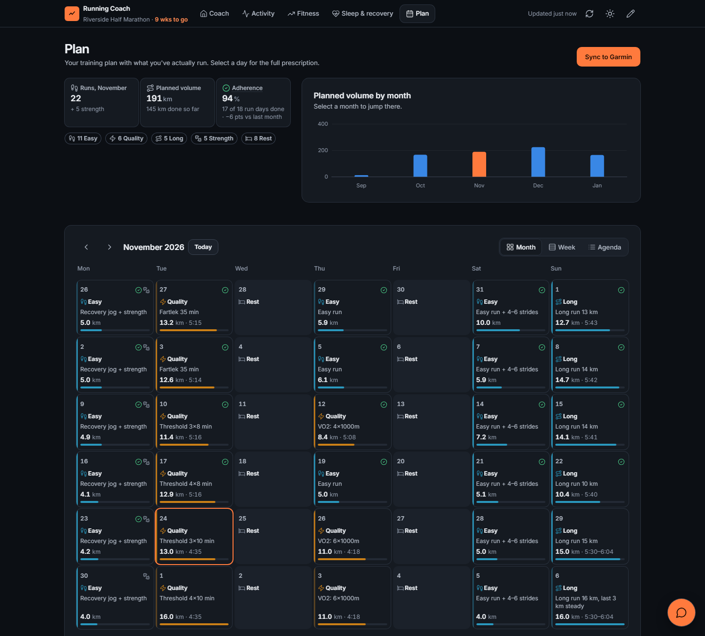
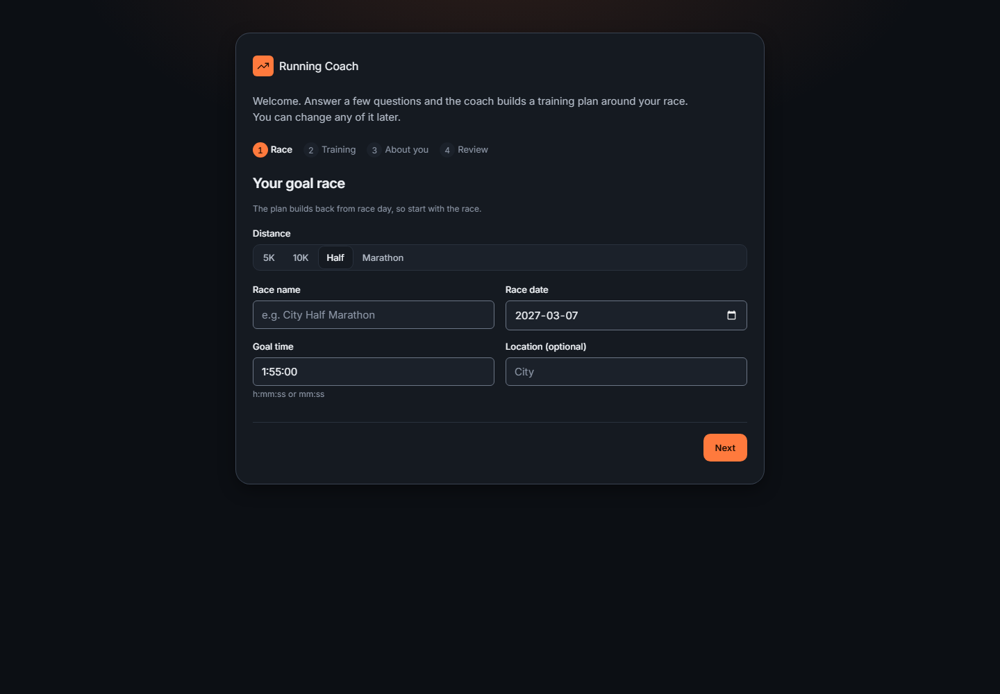

# Running Coach

A self-hosted running dashboard and coach built on **your own Garmin data**. Tell it your goal race
and it builds a periodised training plan, then reads your runs, sleep, HRV and training load every
day to tell you what to run and why.

It runs entirely on your machine: one small Python server and a no-build web UI. Your data stays
in a local folder.



> **Try it in 30 seconds without a Garmin account:** `uv run python backend/app.py --demo`, then
> open http://127.0.0.1:8000. Demo mode loads a fictional runner eight weeks into a half-marathon
> plan. Every screenshot in this README comes from demo mode.

---

## Features

**Plan**
- **Guided setup.** Choose a 5K, 10K, half or marathon, a race date and a goal time. The coach
  builds a base → build → race-specific → taper plan scaled to the weeks you have, with a down week
  every fourth week.
- **Paces from your goal.** Easy, steady, marathon, half-marathon, threshold, 10K, 5K and rep paces
  are derived from your goal time with Jack Daniels' VDOT formula. Heart-rate zones are anchored to
  your lactate threshold.
- **Calendar.** Month, week and agenda views color-coded by intensity, with what you actually ran
  laid over the plan. Select any day for the prescription, the reasoning, a workout blueprint chart,
  bail-out options ("short on time", "legs are tired", "bad weather") and the strength session.
- **Sync to Garmin.** Push upcoming runs, strength and mobility sessions to your Garmin calendar so
  they appear on your watch.

**Coach**
- **Today's call.** Every morning a go / modify / back-off verdict from your readiness, HRV against
  your own baseline, sleep, recovery time and recent load, with the reasoning shown.
- **Adaptive recommendations.** Suggests plan changes (move the long run, cut a session) when the
  signals say so, and learns from the ones you accept or reject.
- **Weather-aware.** Adjusts pace for heat, humidity and wind (Open-Meteo, no account needed).
- **Niggle log.** Track aches and pains. The coach factors them into its advice.
- **Coach chat.** Ask "what should I run today?", "how did my last run go?" or "swap Saturday and
  Sunday". Works out of the box with a built-in rule-based coach. Add your own Anthropic API key to
  upgrade it to a Claude-powered coach that uses the same tools.



**Activity**
- Weekly volume against target, intensity minutes, time in HR zones and a grey-zone check
  (polarised-training balance).
- Running dynamics: cadence, vertical oscillation, ground contact time.
- Drill into any run for its pace / HR / grade-adjusted trace, splits, zones, cardiac drift and
  aerobic decoupling, with a coaching read specific to the workout type.
- A Strava-style training log grouped by week.

**Fitness**
- VDOT trend and race-day projection against your A / B / C goals, with stretch targets.
- Race predictions: Garmin's predictor, a recalibrated VDOT read, and your own entries.
- Fitness / fatigue / form (CTL / ATL / TSB) with the plan's forecast, plus ACWR load balance.
- VO₂max percentile for your age and sex, lactate threshold, training status, heat acclimation,
  real-time stamina, running tolerance, and a body-weight forecast tied to training volume.



**Sleep & recovery**
- Last night's stages, timing, efficiency and score, plus 14-night and 30-night trends.
- HRV and resting heart rate against your two-year baseline, readiness over time, Body Battery.
- Time on your feet and non-activity stress, with weekday-vs-weekend patterns.
- Coaching notes on what to change: bedtime regularity, sleep debt, pre-workout nights.

| | |
|---|---|
|  |  |
|  |  |

**Also**
- Dark and light themes, keyboard accessible, every chart has a "view as table" option.
- Works on your phone's browser (bottom navigation on small screens).
- Every panel shows a "no data yet" state instead of crashing when a metric hasn't synced or your
  watch doesn't record it.

---

## Quick start

### 1. Install

You need [**uv**](https://docs.astral.sh/uv/getting-started/installation/), a fast Python package
manager. It installs the right Python (3.12+) and every dependency for you.

```bash
# macOS / Linux
curl -LsSf https://astral.sh/uv/install.sh | sh
```

```powershell
# Windows (PowerShell)
powershell -ExecutionPolicy ByPass -c "irm https://astral.sh/uv/install.ps1 | iex"
```

Then get the code:

```bash
git clone https://github.com/tipeveryday/running-coach.git
cd running-coach
```

### 2. Try the demo (optional)

```bash
uv run python backend/app.py --demo
```

Open **http://127.0.0.1:8000**. Demo data lives in `demo-data/` and is regenerated each time the
server starts. Stop the server with `Ctrl+C`.

### 3. Connect your Garmin account

```bash
uv run python garmin_login.py
```

It asks for your Garmin Connect email, password and, if Garmin sends one, an MFA code. Only the
resulting session tokens are saved, in `~/.garminconnect/`. Your password is never stored, and
nothing is sent anywhere except Garmin.

### 4. Start the app

```bash
uv run python backend/app.py
```

Open **http://127.0.0.1:8000**. The first time, a short setup asks for your race, goal time and
training volume, then shows the plan before saving it. The app then pulls your last 90 days from
Garmin. This takes about 30 seconds the first time. After that it refreshes on its own when the data
is stale, or when you press the ↻ button.

To change your race or goal later, use the ✎ **Edit setup** button in the top bar. Saving
regenerates the plan.

---

## Configuration

Everything is optional. Copy `.env.example` to `.env` and set what you need:

| Setting | What it does |
|---|---|
| `ANTHROPIC_API_KEY` | Upgrades the chat to a Claude-powered coach. Uses your own key. Without it the rule-based coach answers. |
| `ANTHROPIC_MODEL` | Model for the chat coach (default `claude-opus-5-5`). |
| `APP_PASSWORD` | Requires a password to open the app. Set this before exposing it beyond your own machine. |
| `HOST` / `PORT` | Server bind (default `127.0.0.1:8000`). `HOST=0.0.0.0` makes it reachable from your phone on the same Wi-Fi. |
| `COACH_TZ` | Pins "today" to a timezone, e.g. `America/New_York`, when the server's clock is in another zone. |
| `GARMINTOKENS` | Where Garmin session tokens are stored (default `~/.garminconnect`). |

Command-line flags: `--demo`, `--port 8001`, `--offline` (use cached data only and never log in to
Garmin, handy while hacking on the UI), `--today 2026-05-01` (pretend it's another date) and
`--data-dir PATH`.

### Your data

Everything personal lives in `data/`, which is git-ignored:

```
data/
├─ config.json   your race, goals, paces, HR zones (written by setup; safe to hand-edit)
├─ plan.json     the generated plan (hand-edit distances, reps or segments if you like)
└─ cache/        Garmin snapshot, HRV baselines, coach state, niggle log
```

Delete `data/` to start over from the setup screen.

---

## How it works

```
Garmin Connect ──(python-garminconnect, your session tokens)──▶ backend/garmin_client.py
                                                                   │ normalised snapshot
                                                                   ▼
data/cache/garmin_snapshot.json ◀── FastAPI (backend/app.py) ──▶ coach, fitness, sleep,
                                                                  recovery, activity reads
                                                                   │ JSON API
                                                                   ▼
                                             frontend/ (plain ES modules, Chart.js, no build)
```

| Path | Purpose |
|---|---|
| `backend/app.py` | FastAPI app: API routes, static files, background refresh |
| `backend/plangen.py` | Setup → `config.json` + `plan.json` (VDOT paces, HR zones, periodisation) |
| `backend/garmin_client.py` | Garmin login with saved tokens, plus the snapshot builder |
| `backend/coach.py`, `adaptive.py` | Morning verdict, run analysis, adaptive recommendations |
| `backend/fitness.py`, `sleep.py`, `recovery.py`, `activity.py` | Per-tab analysis |
| `backend/routines.py` | Chat: rule-based intents, plus the optional Claude tool-use loop |
| `backend/garmin_sync.py` | Pushes plan workouts to your Garmin calendar |
| `backend/demo.py` | Synthetic athlete for `--demo` |
| `frontend/` | App shell, page renderers, and the `ui/` component library |
| `DESIGN_SYSTEM.md` | Design tokens and component rules. Read it before changing the UI. |

Run the smoke tests with:

```bash
uv run python tests/test_smoke.py
```

---

## FAQ

**Which watches work?** Any Garmin that syncs to Garmin Connect. Some panels (running tolerance,
real-time stamina, running power, HRV status) need a recent watch that records those metrics.
Without them, those panels show an explanation instead of data.

**Garmin says my login failed or the app shows a 401.** Garmin session tokens expire now and then.
Run `uv run python garmin_login.py` again and press ↻. If you log in many times in a row, Garmin
may rate-limit your IP for a while.

**Does it write anything to my Garmin account?** Only when you press **Sync to Garmin** on the Plan
tab, which schedules workouts tagged `[coach]` on your Garmin calendar. Everything else is read-only.

**Can I use it without Garmin?** Demo mode, yes. Other data sources aren't supported yet.
Contributions are welcome, and `backend/garmin_client.py` shows the snapshot shape a new source
would need to produce.

**What does the chat send to Anthropic?** Nothing unless you set `ANTHROPIC_API_KEY`. With a key, each
chat message is sent along with a short summary of today's plan, readiness and recent runs, so the
coach can answer. The rule-based chat never leaves your machine.

---

## Disclaimers

- **Not medical advice.** Running Coach is a training aid, not a doctor or a certified coach. Listen
  to your body, and see a professional about pain, illness or injury.
- **Unofficial Garmin access.** This project uses the community
  [`python-garminconnect`](https://github.com/cyberjunky/python-garminconnect) library. It isn't
  affiliated with or endorsed by Garmin, and Garmin can change its private API at any time.
- Garmin, Garmin Connect, Strava and Claude are trademarks of their respective owners.

## License

[MIT](LICENSE)
